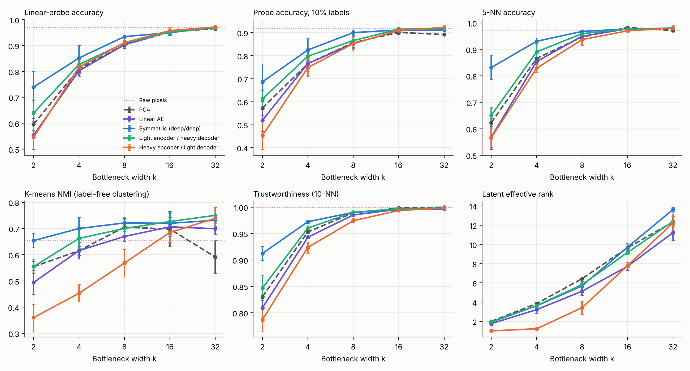
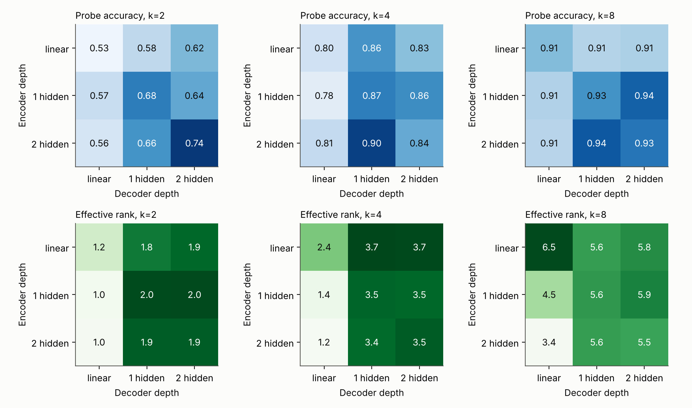
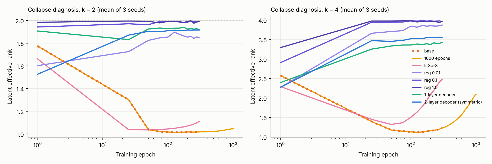
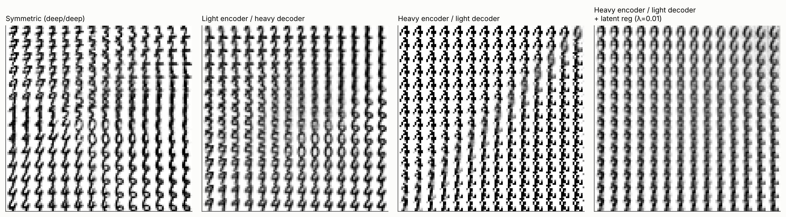

# ASYMMETRIC-ENCODER

**Asymmetric Auto-Encoder Bottlenecks for Self-Supervised Latent Representation Learning**
Team: **Kashvi Agrawal (23BDS0336)**, **Sudeep Sharma (23BDS0315)** · BCSE332L Deep Learning

How does the capacity *asymmetry* between an auto-encoder's encoder and decoder shape the latent space it learns?
This repo is a from-scratch (pure NumPy) study with a depth-grid sweep, a diagnosis of a dimensional-collapse failure,
a latent regulariser, label-efficiency and robustness evaluation, paired statistics, tests, CI and an interactive demo.

[**Live demo: interactive latent-space explorer →**](https://kashviagrawal04.github.io/ASYMMETRIC-ENCODER/demo/) (move over the 2-D latent plane and the trained decoder, running in your browser, paints the digit; source in `demo/`)

## Key findings (sklearn Digits, 5 seeds, a different train/test split per seed)

| Finding | Evidence |
|---|---|
| Symmetric deep AE is best when the bottleneck is narrow (k ≤ 8) | probe acc. 0.740 / 0.852 / 0.935 at k = 2 / 4 / 8 vs 0.545 / 0.817 / 0.912 for heavy-encoder + light-decoder; paired p < 0.05 at k = 2 and 8 |
| A deep encoder with a **single-layer decoder collapses** the latent space | effective rank 1.01 of 2 (k = 2) and 1.23 of 4 (k = 4); K-means NMI 0.36 vs 0.65 for symmetric |
| The collapse is a training plateau, not a capacity limit | rank drops to ≈1 within the first 25–100 epochs, then recovers only slowly (k = 4: ≈2.1 after 1000 epochs; not at all for k = 2) |
| Restoring rank alone does not restore accuracy; adding **one hidden decoder layer** does | VICReg-style regulariser: rank 1.2 → 3.9 but probe unchanged (k = 4); 1-hidden-layer decoder: val probe 0.869 = symmetric |
| The regulariser repairs *clustering* of the collapsed model | NMI +0.15 (k = 2, p = 0.003), +0.17 (k = 4, p = 0.0006), +0.11 (k = 8, p = 0.02) |
| At k ≥ 16 nothing matters on this dataset | all models, PCA and raw pixels within seed noise (0.95–0.97) |
| Training matters most at narrow bottlenecks (random-encoder control) | probe acc. at k = 2: 0.33 untrained vs 0.55–0.74 trained; at k = 32 a random linear projection already reaches 0.948 |
| Bottleneck codes are far more noise-robust than raw pixels | σ = 0.15 noise: 0.84–0.88 (k = 8) vs 0.64 for pixels |

Full write-up: [`report/Asymmetric_AE_Case_Study.pdf`](report/Asymmetric_AE_Case_Study.pdf) (also `.docx`).






## What is in the box

```
asym_ae/            nn.py (layers, manual backprop, Adam) · models.py (depth-configurable AE, latent regulariser)
                    data.py (per-seed splits, shift/rotate/noise test sets) · evaluate.py (metrics) · stats.py (paired tests)
experiments/        run.py (5 stages) · make_figures.py · export_demo.py
demo/index.html     interactive latent explorer (decoder runs in JavaScript)
tests/              18 pytest tests: finite-difference gradient checks for every architecture and the regulariser, metrics, data
results/            raw JSON for every run + summary CSVs + paired-statistics CSVs
report/             case study (docx + pdf)      results/v1, figures/v1: first iteration, kept for reference
```

**Models.** Encoder and decoder depth are set independently (linear / 1 hidden / 2 hidden layers) with a linear k-dim bottleneck.
Named variants: symmetric (2/2), heavy encoder / light decoder (2/0), light encoder / heavy decoder (0/2), linear AE; plus the full 3×3 depth grid.
**Metrics** (labels used only for evaluation): linear probe, 1/5/10/25 %-label probes, 5-NN, K-means NMI, trustworthiness,
latent effective rank, reconstruction MSE, and probe accuracy on shifted / rotated / noisy test images.

## Reproduce

```bash
pip install -r requirements.txt
python -m pytest -q                       # 18 tests
make experiments                          # ~15 min on 2 cores (stages: main, denoise, grid, diagnose, reg, control)
python experiments/make_figures.py        # figures + summary / statistics CSVs
python experiments/export_demo.py         # trains k=2 models, rebuilds demo/index.html
python build_report.py                    # case study (docx)
```

## Honest limitations
Digits is small and easy (1,797 images of 8×8): a linear probe on raw pixels already gets 0.969, so differences vanish at k ≥ 16, and
conclusions about masked-autoencoder-style designs at scale are out of reach. Capacity is not matched across variants, hyper-parameters
are shared (only the regulariser strength was selected, on a validation split), the depth grid and the diagnosis use 3 seeds, and all
networks are MLPs. See the report for details.

## License
MIT © 2026 Kashvi Agrawal
